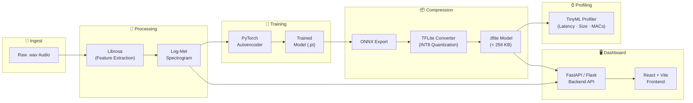
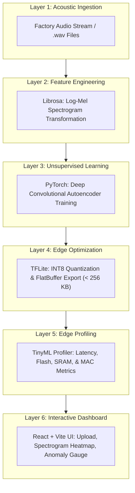

# 🏭 Vision — Tech Stack

> **Industrial Audio Anomaly Detection on the Edge**
>
> A full-stack, TinyML-powered pipeline that listens to factory machinery, learns what "normal" sounds like, and instantly flags anomalies — all visualised through a modern React + Vite dashboard.

---

## Table of Contents

- [Architecture Overview](#architecture-overview)
- [The Tech Stack (In Plain English)](#the-tech-stack-in-plain-english)
  - [1 · Audio Processor — Librosa](#1--audio-processor--librosa)
  - [2 · The AI Brain Framework — PyTorch](#2--the-ai-brain-framework--pytorch)
  - [3 · The Shrink Tool — TensorFlow Lite / TFLite Micro](#3--the-shrink-tool--tensorflow-lite--tflite-micro)
  - [4 · The Performance Profiler — TinyML / Custom Python Profiler](#4--the-performance-profiler--tinyml--custom-python-profiler)
  - [5 · The Dashboard — React + Vite](#5--the-dashboard--react--vite)
- [Layer-by-Layer Breakdown](#layer-by-layer-breakdown)
- [Data Flow](#data-flow)
- [Folder Structure](#folder-structure)
- [Getting Started](#getting-started)
- [License](#license)

---

## Architecture Overview



---

## The Tech Stack (In Plain English)

Think of this project as a **digital factory inspector**. Below are the core tools it needs, explained simply:

---

### 1 · Audio Processor — Librosa

| Property | Details |
|---|---|
| **Role** | The inspector's **"ears"** |
| **What it does** | Raw sound files (`.wav`) are messy. Librosa cleans them up and turns sound waves into a visual picture of frequencies over time (called a **Log-Mel Spectrogram**), which is much easier for an AI to read. |
| **Why it matters** | Raw audio waveforms contain tens of thousands of samples per second with high variance and noise. A Log-Mel Spectrogram condenses this information into a 2D time-frequency heat map matching human auditory perception, enabling standard 2D convolution neural networks to analyze acoustic signatures. |
| **Core Technology** | `librosa` (Python library for audio and music analysis) |

**Core Operations:**
```
 Raw Waveform          →  STFT  →  Mel Filter Bank  →  Log Scaling
 ┌──────────────┐       ┌─────┐    ┌──────────────┐    ┌──────────┐
 │ ∿∿∿∿∿∿∿∿∿∿∿∿ │  ──▶  │ FFT │ ──▶│ 64 Mel Bands │ ──▶│ dB Scale │
 └──────────────┘       └─────┘    └──────────────┘    └──────────┘
                                                         Log-Mel
                                                        Spectrogram
```

**Key Parameters:**
- **Sample Rate (`sr`):** Typically 16,000 Hz or 22,050 Hz.
- **FFT Window (`n_fft`):** 1024 frames.
- **Hop Length (`hop_length`):** 512 frames.
- **Mel Bands (`n_mels`):** 64 or 128 frequency bins.

---

### 2 · The AI Brain Framework — PyTorch

| Property | Details |
|---|---|
| **Role** | The playground where you **design and train** your AI |
| **What it does** | You will build a tiny **Autoencoder** — an AI that learns what "normal" machine sounds look like by trying to compress and reconstruct them perfectly. |
| **How it works** | The Autoencoder compresses spectrograms into a tiny bottleneck latent space (Encoder) and attempts to rebuild the original spectrogram (Decoder). When abnormal sounds occur (e.g., broken bearings, rattling valves), the model struggles to reconstruct them, generating a high **Reconstruction Error (MSE)** that triggers an anomaly alert. |
| **Core Technology** | `torch` / `torchaudio` |

**Autoencoder Flow:**
```
        Input Spectrogram (1 × 64 × 64)
                    │
          ┌─────────▼──────────┐
          │     ENCODER         │
          │  Conv2d → BN → ReLU │ × 3
          │  (compress)         │
          └─────────┬──────────┘
                    │
             Latent Space (z)
              e.g. 1 × 8 × 8
                    │
          ┌─────────▼──────────┐
          │     DECODER         │
          │  ConvT2d → BN → ReLU│ × 3
          │  (reconstruct)      │
          └─────────┬──────────┘
                    │
        Reconstructed Spectrogram
                    │
          Loss = MSE(input, output)
    ──────────────────────────────────
    High loss  →  🔴 ANOMALY
    Low  loss  →  🟢 NORMAL
```

---

### 3 · The Shrink Tool — TensorFlow Lite / TFLite Micro

| Property | Details |
|---|---|
| **Role** | The **file compressor** |
| **What it does** | Standard AI models are massive. This tool acts like a file compressor. It shrinks your PyTorch model down into a tiny **INT8 flatbuffer file** so it occupies **under 256 KB** of space. |
| **Why it matters** | Embedded devices (such as ARM Cortex-M microcontrollers, ESP32, or edge gateways) have strictly constrained SRAM and Flash memory. INT8 quantization converts 32-bit floating-point weights and activations into 8-bit integers, yielding up to a 4x reduction in size and 2-4x speedup with minimal degradation in detection accuracy. |
| **Core Technology** | `TensorFlow Lite`, `TFLiteConverter`, `ONNX`, `TFLite Micro` |

**Conversion Pipeline:**
```
 PyTorch (.pt)
      │
      ▼
 ONNX (.onnx)            ← torch.onnx.export()
      │
      ▼
 TensorFlow SavedModel    ← onnx_tf
      │
      ▼
 TFLite FlatBuffer        ← TFLiteConverter (INT8 Full Integer Quantization)
      │
      ▼
 .tflite (< 256 KB) ✅
```

---

### 4 · The Performance Profiler — TinyML / Custom Python Profiler

| Property | Details |
|---|---|
| **Role** | Your **stopwatch and scale** |
| **What it does** | It measures exactly how many Kilobytes (KB) your model takes up and how fast it processes an audio clip. |
| **Metrics Captured** | Flash memory footprint (KB), peak RAM/tensor arena consumption (KB), inference latency (milliseconds), and Multiply-Accumulate operations (MACs). |
| **Why it matters** | Edge deployment requires hard real-time guarantees and zero memory allocation faults. Profiling ensures the model fits comfortably within hardware budgets before firmware flashing. |
| **Core Technology** | Custom Python Profiler (`time.perf_counter`, `os.path.getsize`), `tflite_runtime.interpreter` |

**Example Profiler Report:**
```
┌────────────────────────────────────────────────────────┐
│               TinyML Profile Summary                   │
├──────────────────────────┬─────────────────────────────┤
│ Metric                   │ Value                       │
├──────────────────────────┼─────────────────────────────┤
│ Binary Size (Flash)      │ 184.2 KB (Target: < 256 KB) │
│ Peak RAM / Tensor Arena  │ 54.8 KB                     │
│ Inference Latency        │ 11.8 ms                     │
│ MAC Operations           │ 1.15 M                      │
│ Precision                │ INT8 Quantized              │
│ Status                   │ ✅ Edge Hardware Ready      │
└──────────────────────────┴─────────────────────────────┘
```

---

### 5 · The Dashboard — React + Vite

| Property | Details |
|---|---|
| **Role** | Your **visual control panel** |
| **What it does** | A lightning-fast, modern web interface where you can upload a sound file, see its spectrogram, watch the AI analyze it in real-time, and display whether it detected an anomaly. |
| **Why React + Vite** | Replacing heavier or slower UI scripts, **React + Vite** provides instant Hot Module Replacement (HMR), component modularity, fluid client-side routing, canvas/WebGL-based spectrogram rendering, and easy integration with production REST APIs or WebSockets. |
| **Core Technology** | `React 18/19`, `Vite`, `Tailwind CSS / Vanilla CSS`, `Lucide Icons`, `Recharts / Chart.js` |

**Frontend Architecture & Features:**
- **Audio Uploader:** Drag-and-drop `.wav` files with instant audio preview and waveform display.
- **Interactive Spectrogram Viewer:** Visual heat map of frequency over time rendered via HTML5 Canvas.
- **Real-Time Anomaly Meter:** Animated gauge displaying the reconstruction error against the anomaly threshold.
- **Performance Card:** Live telemetry showing model latency (ms), Flash size (KB), and status pill (🟢 NORMAL / 🔴 ANOMALY).

---

## Layer-by-Layer Breakdown



---

## Data Flow

```
1. Factory Sound (.wav)
          │
          ▼
2. React + Vite Frontend ──[Upload via HTTP POST /api/analyze]──▶ FastAPI Backend
                                                                     │
                                                                     ▼
                                                             3. Librosa Feature Extractor
                                                                (Generates Log-Mel Matrix)
                                                                     │
                                                                     ▼
                                                             4. TFLite INT8 Runtime
                                                                (Reconstructs Spectrogram)
                                                                     │
                                                                     ▼
                                                             5. Anomaly Detection Logic
                                                                Error = MSE(Input, Output)
                                                                Is Error > Threshold?
                                                                     │
                                                                     ▼
6. React Dashboard ◀──[JSON: Score, Threshold, Latency, Spectrogram]──┘
   │
   ├─ Displays Waveform & Spectrogram Heatmap
   ├─ Animates Anomaly Gauge
   └─ Renders Status: 🟢 NORMAL or 🔴 ANOMALY
```

---

## Folder Structure

```
vision/
├── backend/                      # Python ML & API service
│   ├── app/
│   │   ├── main.py               # FastAPI server entry point
│   │   ├── audio.py              # Librosa feature extraction
│   │   ├── inference.py          # TFLite INT8 inference engine
│   │   └── profiler.py           # Latency & memory profiler
│   ├── models/
│   │   ├── autoencoder.pt        # Trained PyTorch model
│   │   └── autoencoder.tflite    # Quantized INT8 model (< 256 KB)
│   ├── scripts/
│   │   ├── train.py              # PyTorch training script
│   │   ├── convert_tflite.py     # Quantization & export pipeline
│   │   └── run_profiler.py       # Standalone profiler script
│   └── requirements.txt
│
├── frontend/                     # React + Vite dashboard
│   ├── public/                   # Static assets
│   ├── src/
│   │   ├── assets/               # Images and icons
│   │   ├── components/           # UI Components
│   │   │   ├── AudioUploader.jsx # Drag-and-drop file upload
│   │   │   ├── Spectrogram.jsx   # Canvas-based spectrogram viewer
│   │   │   ├── AnomalyGauge.jsx  # Gauge chart for anomaly score
│   │   │   └── MetricsCard.jsx   # Size & latency badge display
│   │   ├── services/             # API client calls (Axios/fetch)
│   │   ├── App.jsx               # Application root
│   │   ├── main.jsx              # Vite entry point
│   │   └── index.css             # Styling & design system
│   ├── index.html
│   ├── package.json
│   └── vite.config.js
│
├── data/                         # Audio samples (normal / anomaly)
│   ├── normal/
│   └── anomaly/
│
├── TECH_STACK.md                 # Complete tech stack documentation
└── README.md                     # Project overview
```

---

## Getting Started

### 1. Prerequisites
- **Python 3.10+**
- **Node.js 18+ & npm**

### 2. Backend Setup
```bash
cd backend
python -m venv .venv
source .venv/bin/activate  # On Windows: .venv\Scripts\activate
pip install -r requirements.txt
uvicorn app.main:app --reload --port 8000
```

### 3. Frontend Setup (React + Vite)
```bash
cd frontend
npm install
npm run dev
```
Visit `http://localhost:5173` to interact with the dashboard.

---

## License

This project is licensed under the MIT License.
